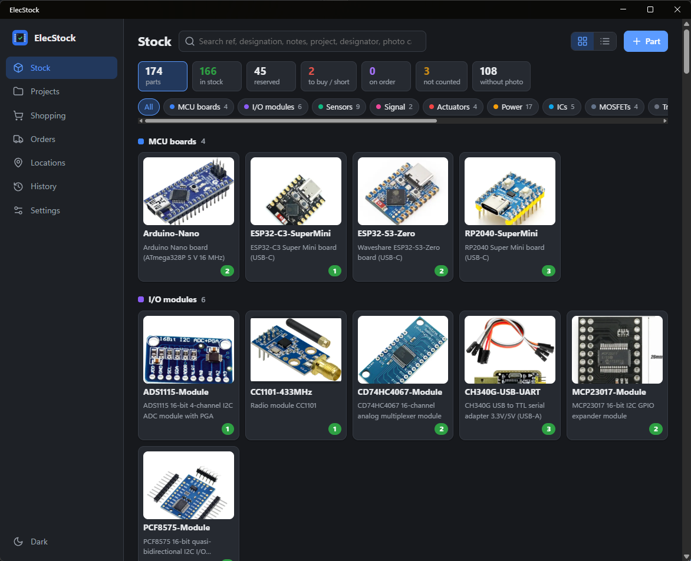

# ElecStock

A self-hosted inventory for a home electronics lab: the parts you have and where they are stored, their
technical sheets, photos and datasheets, the projects and boards that reserve them, what to buy, and the
orders on their way. One server, used from the browser (phone included), from a Windows or Android app, and
by Claude through MCP.



## Features

- **Stock**: tiles by family (photo, or a drawing: resistor colour code, capacitor value, TO-220 / TO-92 /
  DIP package, module, LED colour…) or a sortable list; search over refs, notes, projects, designators,
  photo captions and markers; counters as filters (in stock, reserved, to buy, on order, not counted,
  without photo). Available = qty − reserved, `10+` stays a lower bound, empty = not counted.
- **Part pane**: edit (quantity changes keep their reason), photos (files, phone camera, drag and drop,
  Ctrl+V of a screenshot; caption, numbered markers pinned on the photo, cover), technical sheet
  (Markdown, template), datasheet (offline PDF shown inline, downloaded from the link or attached), free
  notes saved as you type, history.
- **Projects**: project → devices (boards) → revisions with a life cycle (design → PCB ordered → PCB received
  → built), notes and photos at each level. A revision holds its lines (part, qty, designators); each line
  shows the stock state (in stock, short, on order, count needed). Import of a `bom.csv` (simple
  `ref,qty,designation,value,library_ref,supplier,notes` columns, or a KiCad BOM) matched against the stock,
  *mark as built* with a preview, copy of the lines to the next revision, estimated cost from the last
  prices paid.
- **Shopping list and orders**: what is short for the reservations, planned in drafts or out of stock; one
  draft order per supplier; receiving an order adds the quantities to the stock (`10+` + 10 = `20+`).
- **Locations**: boxes and drawers with printable QR labels; scanning one with the phone opens its content.
  Codes group on their own (`DIO` holds `DIO-1`, which holds `DIO-1.1`), and a part can keep the rest of its
  stock in a spare location.
- **History**: every change with its source (Web, App, Claude, Import) and the quantity before / after.
- **Live updates**: a change made anywhere shows at once in every open browser and app.
- **KiCad**: each part links to its symbol, footprint and 3D model; the custom ones are stored on the server
  as the `Stock` library and synced to every PC with one PowerShell line, see [docs/kicad.md](docs/kicad.md).
- **Export / import**: the whole stock as a zip of CSV files, Markdown sheets, photos, datasheets and the KiCad library.
- **MCP**: 26 tools for Claude (search, part with sheet and photos, availability, projects, reservations,
  BOM import, build, shopping, orders…), see [docs/claude.md](docs/claude.md).

> **No authentication.** ElecStock is meant for a trusted home network (reach it from outside through a
> VPN). Do not expose it to the internet.

## Quick start (Docker)

The server image is published on GitHub for each release, for linux-x64 and linux-arm64 (Raspberry Pi 4/5):
`ghcr.io/bisjob/elecstock-server`. Copy [docker-compose.yml](docker-compose.yml) and [env.example](env.example)
next to each other, then:

```bash
cp env.example .env        # set POSTGRES_PASSWORD and PUBLIC_BASE_URL
docker compose pull && docker compose up -d
```

The web UI answers on port 4002. `latest` is the last release; set `ELECSTOCK_TAG` in `.env` to pin one
(`1.0.0`, or `1.0` for its patches).

To build the image yourself (no Dockerfile: the .NET 10 SDK builds it into the local Docker):

```bash
dotnet publish src/ElecStock.Server -c Release -r linux-x64 -t:PublishContainer \
  -p:ContainerRepository=local/elecstock-server -p:ContainerImageTag=latest
```

then set `REPO_URL=local` in `.env` and run `docker compose up -d` (no `pull`).

Data lives in two volumes: `postgres_data` (back it up with `pg_dump`) and `elecstock_data` (photos and
PDFs). The container starts as root, gives `/app/AppData` to the image's `app` user (uid/gid 1654) and runs
the server as that user (`docker-entrypoint.sh`), so a host folder bind-mounted there instead of the volume
works too, even when Docker creates it.

## Apps

- **Browser**: the web UI works on desktop and phone (camera upload, QR labels).
- **Windows**: a MAUI Blazor Hybrid app with the same pages, talking to the server over its HTTP API.
- **Android**: the same app, the APK attached to each [GitHub release](../../releases); the server address
  is set in *Settings*.

The apps talk plain http to the server: see [The MAUI app and plain http](#the-maui-app-and-plain-http).

## Development

Requirements: .NET 10 SDK, the `maui-windows` workload for the Windows app (`maui-android` for Android),
Docker for the database.

1. Start the dev database (once): `docker compose -f postgres-compose/docker-compose.yml up -d`
   (PostgreSQL on port 5433, Adminer on 1457).
2. Run the server: `dotnet run --project src/ElecStock.Server` → http://localhost:5190 (also reachable from
   a phone on the LAN). Migrations are applied at startup.
3. The app (the server address defaults to `http://localhost:5190`, `http://10.0.2.2:5190` on Android,
   i.e. the PC seen from the emulator; a phone sets the server address in Settings):
   - Windows: `dotnet build src/ElecStock.Appli -t:Run -f net10.0-windows10.0.19041.0`;
   - Android emulator: `dotnet build src/ElecStock.Appli -t:Run -f net10.0-android "-p:AdbTarget=-s emulator-5554"`
     (`adb devices` lists the targets);
   - Windows PC, release: `dotnet publish src/ElecStock.Appli -f net10.0-windows10.0.19041.0 -c Release
     -p:PublishProfile=Windows -p:Version=X.Y.Z -o publish/ElecStock` gives a folder to zip and copy, run
     `ElecStock.Appli.exe` (.NET and the Windows App SDK inside, nothing to install). Not a single exe: see
     `Properties/PublishProfiles/Windows.pubxml`. The CI builds the same zip for each release (docs/ci.md).
4. Tests: `dotnet test --project tests/ElecStock.Tests` (the service tests use the `elecstock_test`
   database of the dev compose, recreated for each test, and are skipped when it is not running; with
   `ELECSTOCK_TEST_DB` set, as in the CI, they fail instead).

New migration: `dotnet ef migrations add <Name> --project src/ElecStock.Data --output-dir Migrations`
(`dotnet tool restore` first).

An existing stock can be loaded from *Settings → Import*: a zip in the export format (`inventory.csv`,
`allocations.csv`, sheets, `Media/`, `Datasheets/`), or through the API:

```bash
curl -X POST "http://localhost:5190/api/import?replace=true" -H "Content-Type: application/zip" --data-binary "@stock.zip"
```

### Layout

```
ElecStock-App/
├── src/
│   ├── ElecStock.Core/     ← stock rules (qty, availability), part drawings, BOM parsing, KiCad files, contracts (DTOs, IStockApi)
│   ├── ElecStock.Data/     ← PostgreSQL (EF Core), file storage, StockService, import / export
│   ├── ElecStock.UI/       ← Blazor pages shared by the web server and the MAUI app
│   ├── ElecStock.Server/   ← ASP.NET Core: web UI, HTTP API (/api), KiCad library (/kicad), SignalR (/hubs/stock), MCP (/mcp), container image
│   └── ElecStock.Appli/    ← MAUI Blazor Hybrid client (Windows, Android)
├── tests/ElecStock.Tests/  ← rules, drawings, BOM matching, and service scenarios on a real PostgreSQL
├── postgres-compose/       ← dev database
├── docker-compose.yml      ← deployment
├── .forgejo/workflows/     ← CI on Forgejo Actions (docs/ci.md)
└── docs/                   ← CI, Claude / MCP, KiCad library
```

One `IStockApi`, two implementations: the web host uses `StockService` in-process (Blazor Server),
the MAUI app uses `HttpStockApi` over `/api`. Every change, whoever makes it (web, app, Claude), goes
through `StockService`: it is checked the same way, written to the history with its source, and pushed
to every open client (circuits directly, MAUI apps through SignalR).

### Configuration

`appsettings.json`, or environment variables `Section__Key`:

| Key | Default | |
|---|---|---|
| `ConnectionStrings:Stock` | dev database on 5433 | PostgreSQL |
| `Storage:Root` | `AppData` | photos, thumbnails, datasheets, KiCad files, trash (relative to the app folder) |
| `Storage:MaxPhotoSide` | `2400` | photos larger than this are shrunk on upload |
| `Server:PublicBaseUrl` | (page address) | address of the web UI from the phone, used by the QR labels |
| `Database:MigrateOnStartup` | `true` | |

## Claude (MCP)

The server exposes an MCP endpoint at `/mcp`:

```bash
claude mcp add --transport http --scope user elecstock http://<server>:4002/mcp
```

Claude can then search the stock, read the sheets and photos, reserve parts on a board revision, import a BOM,
plan a build and fill orders. Tools, and a suggested `CLAUDE.md` section: [docs/claude.md](docs/claude.md).

## CI

Development happens on a self-hosted Forgejo, mirrored to GitHub:

- **Forgejo** (`.forgejo/workflows/ci.yml`) builds and tests every push and pull request, and publishes the
  development builds to the Forgejo registry (and, optionally, the APK to a self-hosted F-Droid repository).
- **GitHub** (`.github/workflows/release.yml`) runs on a version tag `vX.Y.Z` pushed by the mirror: tests, the
  multi-arch image on ghcr.io, the signed APK, and the GitHub release.

Details: [docs/ci.md](docs/ci.md).

## The MAUI app and plain http

The MAUI UI runs at `https://0.0.0.1` in its WebView while the server is plain http, so the WebView would
block the server photos and PDFs as mixed content (Android's `MixedContentMode = AlwaysAllow` does not help
on recent WebViews). `HttpStockApi.ResolveUrl` turns `files/…` into `_server/files/…` on the app origin, and
`MainPage` answers those requests (`BlazorWebView.WebResourceRequested`) with the file fetched by the app's
`HttpClient`. Links opened outside the app (full-size photo, PDF, export) use `ExternalUrl`, the server
address. The API calls themselves are .NET `HttpClient` calls; Android allows them with
`usesCleartextTraffic`. Android's WebView has no PDF viewer: there the datasheet opens with *Open the PDF*.

## License

[MIT](LICENSE)
